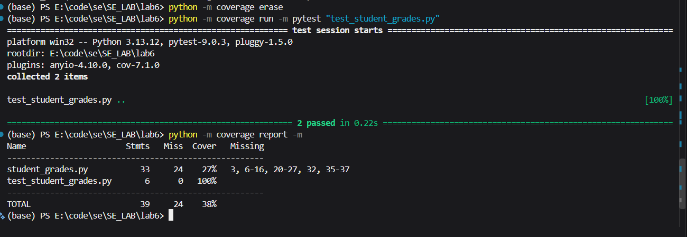
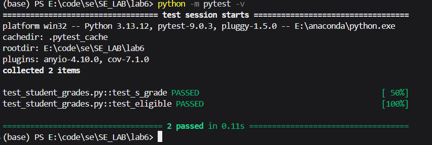
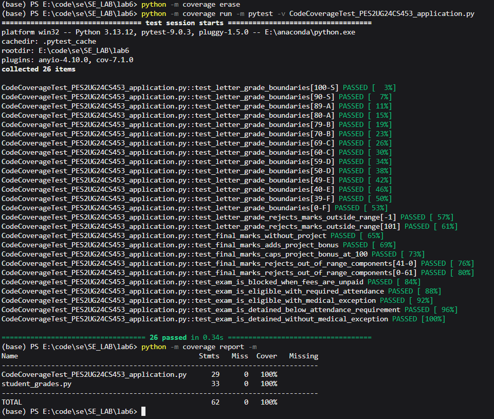
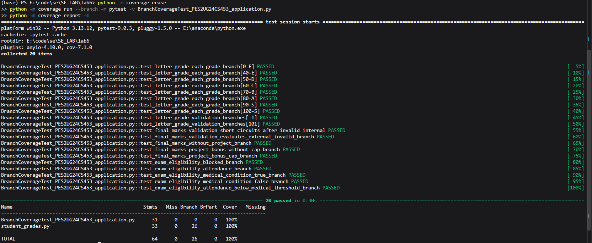

# L6_L7_16_student_grades — Student Grades

Lab 6: Code and Branch Coverage

## About

A small Python module that converts marks to letter grades, works out final marks with a project bonus and checks exam eligibility.

## Files

| File | Description |
|------|-------------|
| `student_grades.py` | The module under test |
| `test_student_grades.py` | Starter test file |

## Screenshots

### Coverage before additional tests

### Pytest before additional tests

### Code coverage after additional tests

### Branch coverage after additional tests

